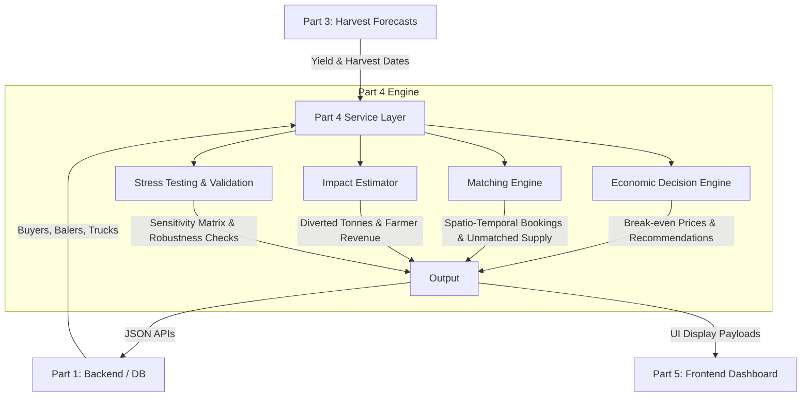

# Residue Compass - Part 4 Architecture

## 1. Role & System Context
Part 4: Economics, Matching, and Validation provides the decision-making intelligence of Residue Compass.
It receives:
- Harvest predictions, straw volume estimates, and crop calendar dates from Part 3 (AI/ML) or Part 1 (Backend Database).
- Active buyer orders, registered machinery (balers, rakes), and logistics capacity (trucks, tractor-trolleys) from Part 1.

It produces:
- Village-level economic valuations (Keep vs. Sell vs. Feed) with break-even buyer offers.
- Spatio-temporal logistics matching and collection bookings.
- Quantified ecological and financial impact metrics (tonnes diverted from burning, net farmer revenue, savings vs. burning).
- Comprehensive stress testing under volatile diesel, straw, and fertilizer markets.

## 2. Module Boundaries
- `schemas.py`: Explicit, validated data structures for forecasts, decisions, buyers, resources, bookings, and stress scenarios.
- `config.py`: Default agronomic parameters (nutrient content per tonne of paddy straw, fertilizer market prices, machinery consumption, transport costs).
- `economics.py`: Deterministic net comparative economic calculation across KEEP, SELL, and FEED.
- `matching.py`: Spatio-temporal greedy scheduling engine adhering to 12 strict operational constraints.
- `impact.py`: Transparent accounting of diverted biomass, farmer revenues, and avoided in-situ burning penalties.
- `validation.py`: Data integrity audits and multi-variable economic sensitivity / stress testing.
- `service.py`: Public API boundary providing clean functions for Part 1 integration.
